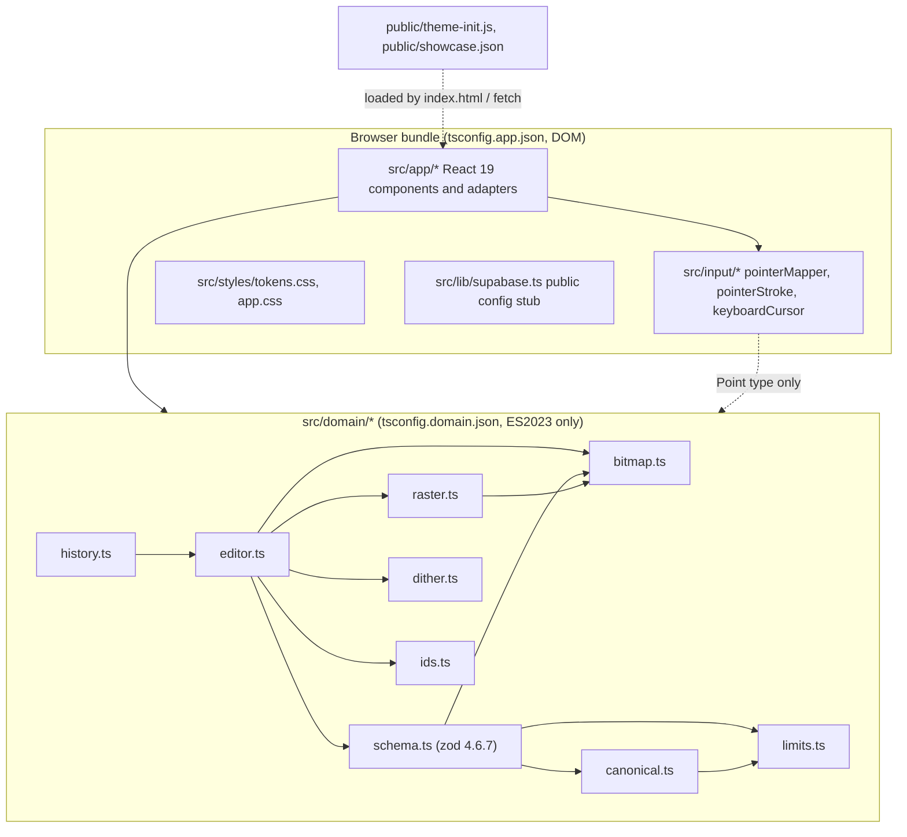

# Design Document

## Overview

Spec 01 delivers the repository scaffold and the local authoring loop for NecroCard: a strict, versioned stack document; card, pixel and widget editing; pointer, touch and keyboard input; a responsive phone/tablet/desktop shell; the spooky dark theme with Light/System modes; JSON export/import; browser-local drafts; and showcase play/fork. Everything in this spec runs in the browser with no backend. `src/lib/supabase.ts` is a public-configuration stub that later specs fill.

Sources: `requirements.md` in this folder is authoritative for behaviour. `NECROCARD_BLUEPRINT_v2.md` controls the stack and architecture (§1.5, §2.1–§2.3, §2.7, §3.3–§3.8, §4.1–§4.4). Values marked "proposed" in the requirements are used as written here.

Design goals, in priority order:

1. A pure, DOM-free domain (`src/domain/`) that holds every rule about document validity, pixels, history and canonical bytes. It is the only place property tests need to reach.
2. Thin React and input adapters that translate events into domain actions and never compute document state themselves.
3. A scaffold whose checks either run for real or are recorded as "not run" with a reason (Requirement 2).

### Key decisions

| ID | Decision | Rationale |
|---|---|---|
| D1 | Domain compiled separately with `tsconfig.domain.json` (`lib: ["ES2023"]`, `types: []`) plus an import allowlist check | Type errors catch DOM globals; the allowlist catches package imports (React, Supabase, MCP) that would otherwise type-check (Req 3.2, 3.3) |
| D2 | Undo stores whole-document snapshots with structural sharing, depth 50 | Documents are immutable values, so a snapshot is one pointer. Canonical equality after undo is exact by construction (Req 11) |
| D3 | Strokes are committed as their sample list; the reducer re-rasterises from the document bitmap | Preview and commit use the same raster code. Keyboard and pointer strokes meet at the same action (Req 23.20) |
| D4 | Draft_Store uses `localStorage`, one key per stack, one `setItem` per save | Synchronous load before first render; `setItem` either replaces the value or throws, which gives the atomic-write guarantee of Req 21.9 with no extra code. Size analysis in Data Models |
| D5 | Canonical_Form is schema-ordered JSON, 2-space indent, LF, one trailing newline, no BOM. Exporter output is exactly the UTF-8 bytes of Canonical_Form | One serializer for export, size limits, comparison and drafts (Req 6.4, 20.1, 20.8) |
| D6 | No jsdom or Testing Library. UI behaviour is tested only through Playwright | Requirement 1.1 forbids packages beyond the pinned list. Logic needing tests is extracted into pure modules |
| D7 | CSP and initial-JS size report are produced by one small Vite plugin in `vite.config.ts`; the CSP string comes from a pure helper in `scripts/lib/csp.mjs` | `dist/_headers` is written in the same build that Netlify publishes; the helper is unit- and property-testable (Req 3.12, 4.3–4.5) |
| D8 | Docker-free backend path: hosted Supabase dev project; the local-stack suite runs only in GitHub Actions | Organisation policy forbids Docker on the development machine (requirements Environment item 2). Spec 01 needs no backend |
| D9 | Reference_Index and Rule_Interpreter are injected ports; spec 01 ships placeholder adapters | Spec 02 owns rule compilation. Spec 01 must not parse rules (Req 12.4, 20.6). Spec 02 must replace `noReferences` with the real Reference_Index before the Rule_Interpreter is enabled in Play_Mode (see Ports) |
| D10 | Local Playwright runs use the installed Google Chrome (`channel: "chrome"`); CI installs Chrome too | No Playwright browser download on this machine; local and CI run the same project config with no environment branch (see Browser tests) |

### Research notes

- Supabase CLI `functions deploy --use-api` bundles on the server and does not need Docker; the CLI changelog recommends it for CI. The server-side bundle limit is 5 MB, and `--use-docker` forces local bundling for larger functions. NecroCard functions are far below that. Sources: [CLI changelog](https://supabase.com/changelog/33613-deploy-edge-functions-from-cli-without-needing-docker-import-files-outside-of-supabase-directory), [bundle size troubleshooting](https://supabase.com/docs/guides/troubleshooting/edge-function-bundle-size-issues), retrieved 2026-11-09.
- Supabase now issues `sb_publishable_…` (public) and `sb_secret_…` (server) keys, and is deprecating the legacy `anon` and `service_role` JWT keys by the end of 2026. Legacy keys are HS256 JWTs whose payload carries `"role"`. The bundle secret check therefore matches both forms. Source: [migrating to new API keys](https://supabase.com/docs/guides/getting-started/migrating-to-new-api-keys), retrieved 2026-11-09.
- Nebius Token Factory documentation shows keys only as `Authorization: Bearer $NEBIUS_API_KEY` and does not publish a key prefix ([API examples](https://docs.tokenfactory.nebius.com/api-reference/examples/text-generation), retrieved 2026-11-09). The Nebius check below therefore uses an exact-value layer plus a heuristic layer (rationale under Check scripts), and is recorded as such in `docs/decisions.md`.
- CSP `style-src` (here inherited from `default-src 'self'`) blocks `style` attributes in markup and `<style>` elements, but not CSSOM writes such as `element.style.left = …`. React's `style` prop uses CSSOM, so widget positioning works under the Req 4.3 policy without `'unsafe-inline'`. Playwright verifies this under the real header (Testing Strategy).
- IEEE 754 division is correctly rounded. Because `(k·a)/(k·b)` and `a/b` have the same exact real quotient, they round to the same double when `k·a` and `k·b` are exact integers. This makes Req 14.3 hold exactly for the integer ranges it specifies.

## Architecture

### Module boundaries



Rules:

- `src/domain/` imports only relative modules inside `src/domain/` and the package `zod`. No `crypto`, `TextEncoder`, `atob`/`btoa`, `structuredClone`, timers or storage; ES2023 lib does not declare them, so use is a type error. UTF-8 length and base64 are implemented in the domain.
- `src/input/` is pure TypeScript too (no DOM types except in the thin event-adapter functions inside `CanvasView.tsx`). It is compiled by `tsconfig.app.json`; its tests run in Node.
- React owns panels, widgets, focus and status text. The canvas renderer owns pixels: `CanvasView` holds a `<canvas>` ref, a 256×160 `ImageData`, and a working `Uint8Array` bitmap during a stroke. React never re-renders per pixel.
- No component reads `localStorage` directly except `draftStore.ts` and `theme.ts`, both of which take a `Storage`-like object so tests can inject a fake.

### File layout created by this spec

| Path | Purpose |
|---|---|
| `index.html` | Entry page; loads `/theme-init.js` as a blocking same-origin classic script in `<head>`, then `/src/main.tsx` as a module |
| `vite.config.ts` | `@vitejs/plugin-react`, the `necrocardHeaders()` plugin (CSP + initial-JS size), and the `test` block for Vitest |
| `src/main.tsx` | Creates the React root, injects `crypto.randomUUID` and `window.localStorage` into the app |
| `src/domain/ids.ts` | `Id` type, UUID text regex, `IdSource` port |
| `src/domain/limits.ts` | Document_Limits constants, `utf8ByteLength`, `codePointLength`, name rules |
| `src/domain/schema.ts` | zod schemas, `validateStack` (structural pre-pass + zod + semantic checks), `Diagnostic` |
| `src/domain/bitmap.ts` | `Bitmap` type, packed get/set, `encodeBitmap`, `decodeBitmap` |
| `src/domain/canonical.ts` | `canonicalize(doc): string` |
| `src/domain/raster.ts` | `linePixels`, `applyPolyline`, `fillRegion` |
| `src/domain/dither.ts` | `BAYER4`, `DITHER_LEVEL`, `ditherPattern(x, y)` |
| `src/domain/editor.ts` | `EditAction` union, `applyAction`, `EditorContext` (ports), blank-stack and fork factories |
| `src/domain/history.ts` | `EditHistory`, `commit`, `undo`, `redo` |
| `src/input/pointerMapper.ts` | `logicalPoint` exactly as blueprint §2.7 plus finite-input checks |
| `src/input/pointerStroke.ts` | Single-active-pointer gate (pure state machine) |
| `src/input/keyboardCursor.ts` | Keyboard_Cursor state machine (Requirement 23) |
| `src/app/AppShell.tsx` | Layout regions, routing (`/` and `/showcase`), session state, focus order |
| `src/app/session.ts` | Session reducer: document, history, selection, tool, modes, zoom, inspector draft |
| `src/app/CardStrip.tsx` | Horizontal card strip (Phone) and vertical CardNavigator (Tablet/Desktop) from one component |
| `src/app/CanvasView.tsx` | Canvas renderer, widget overlay, Draw/Pan, zoom, pointer and keyboard adapters |
| `src/app/ToolDock.tsx` | Tools, Draw/Pan, zoom, undo/redo, add widget |
| `src/app/WidgetInspector.tsx` | Name/label/text/source/geometry form with Apply/Cancel |
| `src/app/SheetOrPanel.tsx` | Shared container: `<dialog>` Sheet on Phone, `<aside>` panel on Tablet/Desktop |
| `src/app/StatusRegion.tsx` | Mode, tool, draft state, cursor and pen labels; polite live region |
| `src/app/ThemeControl.tsx`, `src/app/theme.ts` | Dark/Light/System control; pure resolver and controller hook |
| `src/app/draftStore.ts` | Draft_Store over an injected `Storage` |
| `src/app/exportImport.ts` | Download/Share and file import adapters |
| `src/app/viewport.ts` | Breakpoint constants and `useViewportClass()` |
| `src/app/ports.ts` | Placeholder `ReferenceIndex` and `RuleInterpreter` adapters until spec 02 |
| `src/styles/tokens.css`, `src/styles/app.css` | Theme tokens (§1.5, §4.2) and layout |
| `src/lib/supabase.ts` | Reads `VITE_SUPABASE_URL` and `VITE_SUPABASE_PUBLISHABLE_KEY`; does not import `@supabase/supabase-js` yet |
| `public/theme-init.js` | Theme_Initializer |
| `public/showcase.json` | Lantern Relay Showcase |
| `scripts/check-edge.mjs` | Edge_Checker |
| `scripts/check-bundle-secrets.mjs` | Bundle_Secret_Check |
| `scripts/check-domain-imports.mjs` | Domain import allowlist |
| `scripts/check-tracked-secrets.mjs` | Req 4.17: no tracked file contains a `.my_env` value |
| `scripts/lib/csp.mjs`, `scripts/lib/secretPatterns.mjs` | Pure helpers shared by the Vite plugin, scripts and tests |
| `tests/unit/**`, `tests/properties/**`, `tests/e2e/**` | Vitest unit, fast-check property and Playwright suites |

Paths not named in blueprint §4.1/§4.2 (`index.html`, `vite.config.ts`, `src/main.tsx`, `scripts/check-domain-imports.mjs`, `scripts/check-tracked-secrets.mjs`, `scripts/lib/*`) each get a `docs/decisions.md` entry with the reason (Req 4.1).

### Stroke data flow

```mermaid
sequenceDiagram
    participant U as Pointer or keyboard
    participant CV as CanvasView adapter
    participant IN as input state machines
    participant R as domain raster
    participant S as session reducer
    participant E as domain editor
    U->>CV: pointerdown / Enter
    CV->>IN: gate event (single pointer, mode, tool)
    IN-->>CV: start(sample)
    CV->>R: applyPolyline(working bitmap, [sample])
    CV->>CV: putImageData (preview)
    U->>CV: pointermove / arrow
    CV->>R: applyPolyline(working, [prev, next])
    U->>CV: pointerup / Enter
    CV->>S: dispatch stroke/commit {cardId, tool, samples}
    S->>E: applyAction(doc, action, ctx)
    E->>R: re-rasterise samples on decoded document bitmap
    E-->>S: applied (new doc) or noop
    S->>S: history.commit if applied; schedule draft save
    Note over CV,S: pointercancel / Escape discards the working bitmap; nothing is dispatched
```

## Components and Interfaces

### Domain (`src/domain/`)

```typescript
// ids.ts
export type Id = string;
export const UUID_TEXT = /^[0-9a-fA-F]{8}-[0-9a-fA-F]{4}-[0-9a-fA-F]{4}-[0-9a-fA-F]{4}-[0-9a-fA-F]{12}$/;
export type IdSource = () => Id;            // app injects () => crypto.randomUUID()

// limits.ts
export const LIMITS = {
  cardsMin: 1, cardsMax: 20, widgetsPerCardMax: 40,
  documentBytesMax: 1_048_576, sourceBytesMax: 8_192,
  nameCodePointsMin: 1, nameCodePointsMax: 64,      // proposed
  cardWidth: 256, cardHeight: 160, bitmapBytes: 5_120, bitmapBase64Chars: 6_828,
  historyDepth: 50,                                  // proposed
} as const;
export function utf8ByteLength(s: string): number;   // counts per code point; lone surrogates count 3 (U+FFFD)
export function codePointLength(s: string): number;  // [...s].length

// schema.ts
export type Path = readonly (string | number)[];
export interface Diagnostic {
  code: DiagnosticCode; path: Path; message: string;
  measured?: number; max?: number; otherPath?: Path;
}
export type Validation<T> = { ok: true; value: T } | { ok: false; diagnostics: Diagnostic[] };
export function validateStack(candidate: unknown): Validation<StackDocument>;

// bitmap.ts
export type Bitmap = Uint8Array;                     // length 5,120, packed MSB-first
export type Bit = 0 | 1;
export function createBitmap(): Bitmap;               // all 0
export function getPixel(b: Bitmap, x: number, y: number): Result<Bit>;
export function setPixel(b: Bitmap, x: number, y: number, v: Bit): Result<Bitmap>; // returns a copy
export function encodeBitmap(b: Bitmap): string;
export function decodeBitmap(text: unknown): Result<Bitmap>;

// canonical.ts
export function canonicalize(doc: StackDocument): string;

// raster.ts
export interface Point { x: number; y: number }
export function linePixels(a: Point, b: Point): Point[];          // Bresenham, see Algorithms
export function applyPolyline(b: Bitmap, samples: readonly Point[], v: Bit): Bitmap; // mutates b (working copy)
export function fillRegion(b: Bitmap, seed: Point): Uint32Array;   // region indices, computed on b before writes

// dither.ts
export const BAYER4: readonly (readonly number[])[];
export const DITHER_LEVEL = 6;
export function ditherPattern(x: number, y: number): Bit;

// editor.ts
export interface EditorContext { newId: IdSource; references: ReferenceIndex }
export type ReferenceIndex = (doc: StackDocument, target: { cardId: Id; widgetId?: Id }) =>
  readonly { cardId: Id; widgetId: Id }[];
export type EditResult =
  | { kind: "applied"; doc: StackDocument; label: string }
  | { kind: "noop" }
  | { kind: "rejected"; diagnostics: Diagnostic[] };
export function applyAction(doc: StackDocument, a: EditAction, ctx: EditorContext): EditResult;
export function createBlankStack(ctx: EditorContext): StackDocument;
export function forkStack(doc: StackDocument, ctx: EditorContext): StackDocument;

// history.ts
export function emptyHistory(): EditHistory;
export function commit(h: EditHistory, e: HistoryEntry): EditHistory;
export function undo(h: EditHistory): { history: EditHistory; doc: StackDocument } | null;
export function redo(h: EditHistory): { history: EditHistory; doc: StackDocument } | null;
```

`Result<T>` is `{ ok: true; value: T } | { ok: false; error: string }`. Domain functions never throw for invalid input; they return errors. They may throw only on programmer error (an assertion that a type already guarantees).

`applyAction` contract:

1. Compute the candidate document (new objects only along the changed path).
2. If the candidate is structurally identical to the input (no pixel, field or order change), return `noop`.
3. Run `validateStack(candidate)`. On failure return `rejected` with the diagnostics and the input document is kept by the caller (Req 6.8).
4. Otherwise return `applied`. The caller (session reducer) commits a history entry.

The full `validateStack` per action costs one canonicalisation (≤ 1 MiB string) and 20 bitmap decodes at most. That is cheap for a single commit and is never run per pointer move. If profiling shows a problem, validation of untouched cards can be skipped, but the first version validates everything.

### Input (`src/input/`)

```typescript
// pointerMapper.ts — blueprint §2.7 formula; finite checks added (Req 14.2)
export function logicalPoint(clientX: number, clientY: number,
  rect: { left: number; top: number; width: number; height: number },
  width = 256, height = 160): Result<Point>;

// pointerStroke.ts
export interface PointerGateState { active: number | null; ignored: ReadonlySet<number> }
export type PointerGateInput =
  | { type: "down"; id: number; pointerType: "mouse" | "pen" | "touch"; button: number;
      drawEnabled: boolean; keyboardStrokeActive: boolean }
  | { type: "move" | "up" | "cancel"; id: number };
export type PointerGateOutput = "start" | "sample" | "commit" | "discard" | "ignore";
export function stepPointerGate(s: PointerGateState, e: PointerGateInput): [PointerGateState, PointerGateOutput];

// keyboardCursor.ts
export interface KeyboardCursorState {
  positions: ReadonlyMap<Id, Point>;   // per card, page memory only
  focusedCard: Id | null;
  pen: "up" | "down";
  samples: readonly Point[];
}
export type KeyInput =
  | { type: "focus"; cardId: Id } | { type: "blur" }
  | { type: "arrow"; dir: "left" | "right" | "up" | "down"; shift: boolean; otherModifier: boolean }
  | { type: "space" | "enter" | "escape"; repeat: boolean }
  | { type: "forceEnd" };               // card/tool/mode change, Undo/Redo
export interface KeyContext { tool: "pencil" | "eraser" | "fill"; pointerStrokeActive: boolean; drawEnabled: boolean }
export type KeyEffect =
  | { type: "none"; preventDefault: boolean }
  | { type: "move"; to: Point }
  | { type: "strokeStart"; at: Point }
  | { type: "strokeSample"; to: Point }
  | { type: "strokeCommit"; samples: readonly Point[] }
  | { type: "strokeDiscard" }
  | { type: "pixel"; at: Point }        // dispatched as stroke/commit with one sample
  | { type: "fill"; at: Point };
export function stepKeyboard(s: KeyboardCursorState, e: KeyInput, c: KeyContext): [KeyboardCursorState, KeyEffect];
```

### App (`src/app/`)

| Component | Responsibility | Key interface |
|---|---|---|
| `AppShell` | Chooses route (`/` opens latest draft or blank; `/showcase` opens the Showcase in Play_Mode), renders regions in focus order, owns the session reducer, flushes pending draft saves before switching documents | `<AppShell deps={{ newId, storage, matchMedia, interpreter, references }} />` |
| `CardStrip` | One list of card buttons; `orientation="horizontal"` (Phone strip, `overflow-x: auto`) or `"vertical"` (navigator). Add, rename, move earlier/later, delete | `cards`, `currentCardId`, callbacks |
| `CanvasView` | `<canvas width=256 height=160>` scaled by CSS; widget overlay in the same transformed box; pointer and keyboard adapters; Draw/Pan; zoom | `card`, `tool`, `zoom`, `inputMode`, `onCommit(action)` |
| `ToolDock` | Pencil, Eraser, Dither fill, Draw/Pan, zoom 1×/2×/4×, Undo, Redo, add Button/Field; `aria-pressed` on toggles | session slice + dispatch |
| `WidgetInspector` | Edits held as an unapplied draft in the session (`inspectorDraft`), so a layout switch keeps them (Req 15.9). Apply dispatches one action per changed field; Cancel/Escape clears the draft | `widget`, `draft`, `onApply`, `onCancel` |
| `SheetOrPanel` | Phone: `<dialog>` opened with `showModal()`, focus moved in, Tab wrap, Escape = Cancel, focus returned to opener. Tablet/Desktop: `<aside aria-labelledby>` side panel, collapsible on Tablet | `title`, `open`, `onCancel`, `footer` (Apply/Cancel/Close) |
| `StatusRegion` | Visible labels plus a `role="status"` polite live region; announces changes, never takes focus | `mode`, `tool`, `draftState`, `cursor`, `pen` |
| `ThemeControl` | Three-option radio group Dark/Light/System | `preference`, `onSelect` |

Ports (`src/app/ports.ts`):

- `noReferences: ReferenceIndex` returns `[]`. Until spec 02 replaces it, deleting a card or widget is never blocked by references. This is a known temporary gap of Req 7.4/7.6, kept deliberately: rules do not execute in spec 01, so a dangling reference cannot cause a runtime failure. Two rules bound the gap, and both are stated in the `docs/decisions.md` entry:
  - Spec 02 must replace `noReferences` with the real Reference_Index before the Rule_Interpreter is enabled in Play_Mode.
  - Until then, no deletion path may edit the Showcase. The Showcase opens only in Play_Mode, where delete controls are not rendered, and the session reducer refuses `card/delete` and `widget/delete` while `source === "showcase"`. Deletions are possible only in a Fork, and `public/showcase.json` is never written.
- `placeholderInterpreter: RuleInterpreter` receives `(doc, cardId, buttonId, playState)` and returns the unchanged play state with the message "Rules run once the rule engine (spec 02) lands". The Play_Mode UI calls this port for every Button press (Req 22.2).

## Data Models

### Stack document (blueprint §2.3)

```typescript
export interface StackDocument {
  format: "necrocard";
  schemaVersion: 1;
  id: Id;
  title: string;
  cardOrder: Id[];
  cards: Record<Id, Card>;
}
export interface Card {
  id: Id; name: string; width: 256; height: 160;
  bitmapBase64: string;        // 6,828 chars, see Algorithms
  widgets: Widget[];           // array order = overlay paint order and Tab order
}
export type Widget = {
  id: Id; name: string; x: number; y: number; width: number; height: number;
} & ({ kind: "button"; label: string; source: string } | { kind: "field"; text: string });
```

The zod schema uses `z.strictObject` for every object (unknown keys rejected), `z.literal("necrocard")`, `z.literal(1)`, `z.number().int()` for geometry, `z.discriminatedUnion("kind", [...])` for widgets and `z.record(z.string().regex(UUID_TEXT), card)` for `cards`. IDs use the `UUID_TEXT` regex rather than `z.uuid()`, because Req 6.1 accepts any 8-4-4-4-12 hexadecimal text, not only RFC 4122 variants. Duplicate-ID comparison lowercases IDs so the same UUID in two cases counts as a duplicate.

`validateStack` runs three passes and returns diagnostics in a deterministic order (pass order, then document order). The first diagnostic is the "first failing path" for Importer and Exporter messages.

1. **Structural pre-pass** over the raw value, iterative with an explicit stack: reject non-finite numbers, keys `__proto__`, `constructor`, `prototype` (checked with `Object.keys`, so a JSON-parsed own `__proto__` key is found), and nesting deeper than 8 levels.
2. **zod parse** for shape and types. zod issues are mapped to `Diagnostic` with the zod issue path.
3. **Semantic checks**: `cardOrder` is a permutation of `Object.keys(cards)`; each card `id` equals its key; 1–20 cards; ≤ 40 widgets per card; geometry bounds (Req 6.3); `bitmapBase64` decodes to 5,120 bytes; names and title have 1–64 code points and are not whitespace-only (`/^\s*$/u`); card names unique in the stack and widget names unique per card (exact, case-sensitive); no ID shared by two objects; each Button `source` ≤ 8,192 UTF-8 bytes; `utf8ByteLength(canonicalize(doc)) ≤ 1,048,576`. Limit diagnostics carry `measured` and `max`; equality with the maximum is accepted (Req 6.4).

The schema has no property for theme, zoom, selection, history, keyboard cursor or play state; such keys fail the strict-object check (Req 6.10).

Defaults (proposed values from the requirements):

| Item | Default |
|---|---|
| Stack title | `"Untitled stack"` |
| Card name | `"Card N"`, smallest positive N not used by another card |
| Button | name `"Button N"`, label `"Button"`, source `""`, x 8, y 8, width 64, height 16 |
| Field | name `"Field N"`, text `""`, x 8, y 32, width 120, height 24 |

N for widgets is the smallest positive integer unused on that card.

### Editor actions

```typescript
export type EditAction =
  | { type: "card/add"; afterCardId: Id }
  | { type: "card/rename"; cardId: Id; name: string }
  | { type: "card/move"; cardId: Id; direction: "earlier" | "later" }
  | { type: "card/delete"; cardId: Id }
  | { type: "widget/add"; cardId: Id; kind: "button" | "field" }
  | { type: "widget/update"; cardId: Id; widgetId: Id;
      patch: { name?: string; label?: string; text?: string; source?: string } }
  | { type: "widget/move"; cardId: Id; widgetId: Id; dx: number; dy: number }       // drag total or ±1 nudge; clamped
  | { type: "widget/resize"; cardId: Id; widgetId: Id; dw: number; dh: number }     // handle drag or Shift+arrow; clamped
  | { type: "widget/setGeometry"; cardId: Id; widgetId: Id;
      field: "x" | "y" | "width" | "height"; value: number }                        // numeric; rejected if out of range
  | { type: "widget/delete"; cardId: Id; widgetId: Id }
  | { type: "stroke/commit"; cardId: Id; tool: "pencil" | "eraser"; samples: Point[] }
  | { type: "fill/apply"; cardId: Id; x: number; y: number };
```

Rejections that the UI explains (Req 7.5, 7.6, 7.7, 7.10, 12.5, 12.6, 12.8, 12.9, 13.4) carry a `DiagnosticCode` such as `last-card`, `referenced`, `card-limit`, `name-empty`, `name-too-long`, `name-duplicate`, `source-too-large`, `widget-limit`, `document-too-large`, `geometry-range`. `referenced` diagnostics list every referencing `{cardId, widgetId}`, and the App_Shell renders them as card and widget names. Moving the first card earlier or the last card later is a `noop` and the button is disabled (Req 7.11). Widget move/resize with zero effective change after clamping is a `noop` (Req 13.2). `stroke/commit` samples must be integers with |v| ≤ 4,096, otherwise `rejected`.

### Edit history

```typescript
export interface HistoryEntry { before: StackDocument; after: StackDocument; label: string }
export interface EditHistory { undo: readonly HistoryEntry[]; redo: readonly HistoryEntry[] } // undo: oldest first
```

`commit` appends to `undo`, drops the oldest entry when the length would exceed 50, and empties `redo`. `undo` pops the last entry, pushes it on `redo` and returns `before`; `redo` does the reverse and returns `after`. `noop` and `rejected` results never reach `commit` (Req 11.9, 11.10). Opening any document resets history to empty (Req 11.11). Worst-case memory is 50 snapshots, and because documents share unchanged cards, a typical stroke entry costs one new 6,828-character string plus a few small objects.

### Session state (`src/app/session.ts`, never persisted in the document)

```typescript
interface Session {
  doc: StackDocument; history: EditHistory; source: "draft" | "showcase" | "fork" | "import" | "new";
  mode: "edit" | "play"; currentCardId: Id; selectedWidgetId: Id | null;
  tool: "pencil" | "eraser" | "fill"; inputMode: "draw" | "pan"; zoom: 1 | 2 | 4;
  inspectorDraft: { widgetId: Id; values: Record<string, string> } | null;
  panelCollapsed: boolean; draftState: "unsaved" | "saving" | "saved" | "unavailable" | "none";
  play: { score: number; cardId: Id } | null;   // local game state, discarded on reload (Req 22.6)
  message: { text: string; kind: "info" | "error" } | null;
}
```

The Keyboard_Cursor state lives in a `useRef` inside `CanvasView`, not in the session or document (Req 23.6). Theme lives in `theme.ts`. Leaving Play_Mode clears `play` and restores the same `doc` object (Req 22.7).

### Draft_Store record

| Item | Value |
|---|---|
| Storage | `window.localStorage` (injected) |
| Key | `necrocard.draft.v1.<stackId>` |
| Value | JSON text `{"v":1,"savedAt":"<ISO-8601 UTC>","document":<StackDocument>}` |
| Load | Enumerate keys with the prefix; parse each; open the one with the latest `savedAt` that validates. If the latest fails to parse or validate, keep it untouched, show the recovery message with "Export raw draft" (exports the stored string byte-for-byte) and open a blank stack (Req 21.6) |
| Save | One `setItem` per save, last-write wins for that stack ID |

Why localStorage and not IndexedDB:

- A full 20-card stack with no text is 20 × 6,828 = 136,560 bitmap characters plus small JSON, about 140 KB. The hard ceiling is a 1 MiB canonical document.
- Browsers give localStorage roughly 5 MB per origin, counted in UTF-16 code units by some engines, so a 1 MiB document can cost up to 2 MiB. Several typical drafts fit; a few maximum-size drafts may not.
- When the quota is exceeded, `setItem` throws and leaves the previous value under that key intact. That maps directly onto Req 21.5 (show "Local saving unavailable", offer Export, retry on next commit) and Req 21.9 (previous draft stays loadable).
- Synchronous reads let `AppShell` open the latest draft in its first render, without a loading state.
- IndexedDB offers a larger quota but needs async open, transaction code and a loading state. It is the fallback if the device matrix shows quota failures with real stacks. No automatic eviction of old drafts is designed (YAGNI); Export is the documented backup (Req 21.7).

A synchronous write of up to 2 MiB blocks the main thread for a few milliseconds at most once per second, which is acceptable.

### Theme preference

| Item | Value |
|---|---|
| Key | `necrocard.theme` in localStorage |
| Stored values | `"dark"`, `"light"`, `"system"`; nothing stored until the Creator selects (Req 17.1) |
| DOM | `<html data-theme="dark|light" data-theme-preference="dark|light|system">` |
| Invalid or unreadable | Treated as Dark; stored value is left as is (Req 17.6) |

### Showcase

`public/showcase.json` is a Canonical_Form Stack_Document "Lantern Relay" with five cards (Start, Courtyard, Tower, Gate, Win). Button `source` text uses the blueprint §1.3 grammar but is not parsed in spec 01. Artwork is drawn by the team in NecroCard itself and exported, which keeps provenance simple (Req 22.5). A unit test validates the file and checks its limits.

## Algorithms

### Canonical_Form (`canonical.ts`)

```text
canonicalize(doc):
  out = { format, schemaVersion, id, title, cardOrder (array order kept), cards: {} }
  for id in Object.keys(doc.cards) sorted by ascending UTF-16 code units:
    c = doc.cards[id]
    out.cards[id] = { id, name, width, height, bitmapBase64,
                      widgets: c.widgets.map(orderWidget) }      // array order kept
  orderWidget(w) = { id, name, kind, x, y, width, height, label, source }   // button
                 | { id, name, kind, x, y, width, height, text }            // field
  return JSON.stringify(out, null, 2) + "\n"
```

- Two-space indent, LF line breaks (JSON.stringify emits `\n`), one trailing newline, no BOM. Strings use JSON.stringify escaping; ES2019+ escapes lone surrogates, so output is always well-formed.
- `cards` key order is independent of `cardOrder`, so two documents with the same meaning always serialize identically. Card IDs contain hyphens and so are never integer-like keys, which keeps JavaScript's property-order rules from reordering them.
- **The Exporter output is exactly the UTF-8 encoding of `canonicalize(doc)`.** Import then export therefore reproduces the original bytes (Req 20.8). The Draft_Store embeds the document object in its record; the record itself is not canonical.

### Bitmap packing and base64 (`bitmap.ts`)

- Pixel (x, y): `i = y·256 + x`, byte `i >> 3`, bit `7 − (i & 7)`; 1 = ink, 0 = paper (Req 8.1).
- 5,120 bytes = 1,706 full 3-byte groups (5,118 bytes) plus 2 bytes. Encoding gives 1,706 × 4 + 4 = **6,828 characters**, the last group being three data characters and one `=`.
- The final data character (index 6,826) carries 4 data bits and 2 unused bits, so its alphabet index must satisfy `index & 0b11 === 0`.
- `decodeBitmap(text)` accepts only: `typeof text === "string"`, `text.length === 6828`, `/^[A-Za-z0-9+/]{6827}=$/`, the unused-bits rule, and a decoded length of 5,120. Any failure returns an error before allocating output, so no partial bitmap escapes (Req 8.5).
- The encoder and decoder are table-driven pure TypeScript; `atob`/`btoa` are not available under the domain lib.

### Line rasterizer (`raster.ts`)

Integer Bresenham with an explicit tie rule. For segment a → b: `dx = b.x − a.x`, `dy = b.y − a.y`, `n = max(|dx|, |dy|)`. The major axis is x when `|dx| ≥ |dy|`, otherwise y; `m` is the absolute minor delta and `s` its sign.

```text
if n == 0: return [a]
acc = n; minor = 0
for t in 0..n:
  emit (major = a.major + sign(major delta)·t, minor = a.minor + s·minor)
  acc += 2m
  if acc >= 2n: minor += 1; acc -= 2n
```

This equals the closed form `minorOffset(t) = floor((2·t·m + n) / (2·n))`:

- Each step advances the major axis by exactly 1 and the minor axis by 0 or 1, so the line is 8-connected and has exactly `n + 1` pixels including both endpoints (`minorOffset(n) = m`) (Req 9.1, 9.2).
- **Tie rule:** when `t·m/n` is exactly k + ½, the minor coordinate rounds up, which means toward the end point. Lines are therefore direction-dependent on tie pixels. Samples are always applied in arrival order, so pointer and keyboard strokes with the same sequence produce the same pixels.

`applyPolyline(bitmap, samples, v)` sets the first sample, then each consecutive segment. Pixels outside 0–255 × 0–159 are skipped (clipped) while in-range pixels of the same segment are still written (Req 9.4). Mapper-clamped samples never leave the bitmap, but the reducer still handles any integer within ±4,096.

### Dither_Fill (`raster.ts`, `dither.ts`)

Iterative 4-connected flood fill, no recursion:

```text
target = getPixel(seed)
visited = Uint8Array(40960); stack = Int32Array(40960); top = 0
push(seedIndex); visited[seedIndex] = 1
while top > 0:
  i = pop(); region.add(i)
  for each 4-neighbour j of i inside the bitmap:
    if !visited[j] and pixel(j) == target: visited[j] = 1; push(j)
```

Marking at push time bounds the stack at 40,960 entries. The region is computed entirely on the pre-fill bitmap, then each region pixel is set to `ditherPattern(px, py)`. If no region pixel's pattern value differs from `target`, the result is `noop` and no history entry is added (Req 10.7).

Dither_Pattern, one 4×4 Bayer matrix at one fixed level:

```text
BAYER4 = [[ 0,  8,  2, 10],
          [12,  4, 14,  6],
          [ 3, 11,  1,  9],
          [15,  7, 13,  5]]
DITHER_LEVEL = 6
ditherPattern(x, y) = BAYER4[y & 3][x & 3] < 6 ? 1 : 0     // 6 of 16 = 37.5 % ink
```

The value depends only on absolute coordinates, so adjacent fills tile seamlessly (Req 10.4). Level 6 was chosen because levels 4 and 8 of this matrix collapse to a plain grid and a checkerboard.

### Undo and redo

Snapshot history as defined in Data Models: depth 50, redo cleared by any new commit, opening a document clears both stacks. A Stroke, a Dither_Fill and each keyboard nudge is one entry (Req 9.5, 10.5, 13.2).

### Draft save timing

```text
on applied commit:   draftState = "unsaved"; if no timer: timer = setTimeout(save, 1000)
save():              draftState = "saving"; try storage.setItem(key, record(latestDoc))
                     ok   -> draftState = "saved"
                     fail -> draftState = "unavailable" (Export shown; next commit retries)
flush now on:        pagehide, visibilitychange to hidden, and before switching document
                     (import, fork, showcase, new blank)
```

Commits inside the 1-second window ride along, so every commit is saved within about 1 s plus write time, inside the 2-second bound of Req 21.1. The label changes as soon as `setItem` returns (Req 21.4).

### UUID generation

`EditorContext.newId` is injected. `src/main.tsx` passes `crypto.randomUUID()` when available. `crypto.randomUUID` exists only in secure contexts, so phone testing over a LAN `http://192.168.…` dev URL would lack it; the fallback builds a version-4 UUID from `crypto.getRandomValues`, which works in insecure contexts. Tests inject a deterministic counter, for example `00000000-0000-4000-8000-${n.toString(16).padStart(12, "0")}`.

## Input Handling

### Pointer Events

`CanvasView` listens to `pointerdown`, `pointermove`, `pointerup`, `pointercancel` and `lostpointercapture` on the drawing surface and feeds them through `stepPointerGate`:

| Gate state | Event | Condition | Output | Next state |
|---|---|---|---|---|
| idle | down | Draw disabled (Play_Mode, Pan_Mode), mouse button ≠ 0, or a keyboard Stroke is active | ignore | idle; pointer added to `ignored` |
| idle | down | otherwise | start; `setPointerCapture(id)` | active = id |
| active = a | down, id ≠ a | — | ignore | `ignored` += id |
| active = a | move a | — | sample | unchanged |
| active = a | up a | — | commit | idle |
| active = a | cancel a or lost capture without up | — | discard | idle |
| any | move/up/cancel of an id in `ignored` | — | ignore | up/cancel removes it from `ignored` |

- Every sample re-reads `canvas.getBoundingClientRect()`; there is no cached rectangle, so resize, rotation, scroll and zoom changes mid-stroke map correctly (Req 14.5).
- Invalid geometry from `logicalPoint` drops that sample only (Req 14.14).
- Pencil/Eraser: start applies the first sample to the working bitmap; samples extend the polyline; commit dispatches `stroke/commit`; discard restores the canvas from the document bitmap.
- Dither_Fill: start records the mapped point; commit dispatches `fill/apply` at that point; discard does nothing.
- Widget drag and resize use the same gate on the overlay, dispatching one `widget/move` or `widget/resize` with the total logical delta at pointer-up, and nothing on cancel (Req 13.1, 13.6, 13.8, 13.10).

### Draw/Pan, touch-action and zoom

- `touch-action: none` is set only on `.canvas-surface[data-mode="draw"]` (blueprint §4.2 CSS). In Pan_Mode the attribute changes to `pan`, the gate ignores downs, and the Canvas_View region (`overflow: auto`) scrolls natively (Req 14.8, 14.9, 14.16). Nothing else in the page disables scrolling or zoom (Req 14.10).
- Display scale in CSS px per logical pixel is `fit × zoom`, where `fit = max(1, floor(regionWidth / 256))` is measured with a `ResizeObserver` on the Canvas_View region and `zoom ∈ {1, 2, 4}`. At a 320 px phone, fit is 1 and 1× shows all 256 × 160 pixels (Req 5.1). Integer scaling keeps blocks uniform with `image-rendering: pixelated` (Req 14.13).
- The widget overlay is an absolutely positioned box of the same CSS size as the canvas. Widgets are placed at `x·scale`, `y·scale` through React's `style` prop, so overlay and bitmap share one transform and align exactly (Req 13.7).
- Draw/Pan and the three zoom buttons are `<button aria-pressed>` elements in the tool dock (Req 14.11).

### Keyboard pixel cursor (`keyboardCursor.ts`)

The drawing surface is a focusable element (`tabIndex=0`, `role="application"`, accessible name "Drawing surface, <card name>", described by a short key-help text). The state machine runs only while Edit_Mode and Draw_Mode are active and the surface has focus. Every handled key calls `preventDefault()` so the page does not scroll (Req 23.7, 23.8, 23.11, 23.12).

| Pen | Input | Condition | Effect | Next |
|---|---|---|---|---|
| — | focus(card) | first focus of this card in the page session | cursor at (128, 80) | |
| — | focus(card) | card seen before | restore saved position | |
| up | arrow, no Ctrl/Alt/Meta | — | move 1 px (Shift: 8 px), clamped | |
| down | arrow, no Ctrl/Alt/Meta | position changed | move + strokeSample | samples += position |
| down | arrow | clamped, no change | none | |
| any | arrow with Ctrl/Alt/Meta | — | none, default not prevented | |
| up | Space | Pencil/Eraser, no pointer stroke, not repeat | pixel (dispatched as `stroke/commit` with one sample) | |
| up | Space | Dither_Fill, no pointer stroke, not repeat | fill (`fill/apply`) | |
| down | Space | — | none (Req 23.21) | |
| up | Enter | Pencil/Eraser, no pointer stroke, not repeat | strokeStart (first sample = cursor) | down |
| up | Enter | Dither_Fill | none | |
| down | Enter | not repeat | strokeCommit(samples) | up |
| down | Escape | not repeat | strokeDiscard | up |
| up | Escape | — | none | |
| any | Space/Enter/Escape | `event.repeat` | none | |
| any | Space/Enter | pointer stroke active | none (Req 23.22) | |
| down | blur, or forceEnd | — | strokeCommit(samples) | up |

- Tab and Shift+Tab are not handled, so the browser moves focus; the resulting `blur` commits an open stroke first (Req 23.17, 23.18). Window focus loss also fires `blur` on the focused element; `visibilitychange` to hidden sends `forceEnd` as well.
- Before AppShell changes card, tool, mode or runs Undo/Redo, it calls the `CanvasView` imperative handle `endKeyboardStroke()`, which dispatches the commit synchronously ahead of the requested action (Req 23.18).
- Arrow keys on the widget overlay are handled by the overlay and never reach this machine (Req 23.10). Arrow keys on the drawing surface never dispatch widget actions (Req 23.9).
- Cursor outline: a 2 CSS px square ring in `#C2185B` drawn on an overlay layer. Calculated WCAG contrast is about 5.9:1 against paper `#FFFFFF` and about 3.1:1 against ink `#121416`; canvas colours are theme-independent, so the same value works in both themes. Contrast checked and approved by the team (user-reported, 2026-11-09). The ring never touches bitmap data (Req 23.1).
- The Status_Region shows `x X, y Y` and "pen down"/"pen up" while the surface has focus (Req 23.2, 23.3).

## Responsive Layout and Theming

### Breakpoints and regions

`src/app/viewport.ts` exports `PHONE_MAX = 767` and `TABLET_MAX = 1199`. CSS media queries use the same numbers (`min-width: 768px`, `min-width: 1200px`), and a unit test reads `app.css` to check that they match. `useViewportClass()` uses `matchMedia` listeners so the Sheet/panel choice changes without reload (Req 15.8).

| Viewport_Class | Grid | Notes |
|---|---|---|
| Phone 320–767 | header / card strip / canvas / status; tool dock `position: fixed; bottom: 0` | Main area gets `padding-bottom` = dock height + `env(safe-area-inset-bottom)`; Inspector opens as a Sheet |
| Tablet 768–1199 | header spanning; canvas + one side panel (navigator and Inspector) | Collapse/expand button toggles `panelCollapsed` only (Req 15.3) |
| Desktop ≥ 1200 | header; navigator 12rem / canvas / Inspector 20rem | Three non-overlapping regions (Req 15.4) |

- DOM order is header → card navigator/strip → canvas and widget overlay → tool dock → panel, which gives the required Tab order in every class (Req 19.3). CSS grid handles the visual placement.
- `html { scroll-padding-bottom: calc(var(--dock-h) + env(safe-area-inset-bottom)) }` keeps a focused control from sitting under the fixed dock (Req 19.2).
- Primary_Controls use `min-height: 3rem; min-width: 3rem` with a gap of at least 0.25rem between targets (Req 16.1). Inputs use `font-size: 1rem` (16 px) (Req 16.2).
- No component hides a function by Viewport_Class; on Phone, the Inspector, export and import move into the Sheet or the dock overflow, reachable with one activation (Req 15.5, 15.6).

### Sheet/panel container

- Phone: `<dialog class="sheet">` anchored to the bottom, `max-height: 85vh; max-height: 85dvh` (the second line overrides where supported), flex column with a fixed header, a scrolling body (`overflow-y: auto; overscroll-behavior: contain`) and a fixed footer holding Apply/Cancel/Close. The footer therefore stays visible at every scroll position (Req 15.10, 16.5, 16.6). Padding uses `env(safe-area-inset-*)` on each edge it touches (Req 16.3).
- Viewport meta: `width=device-width, initial-scale=1, viewport-fit=cover, interactive-widget=resizes-content`. With a `visualViewport` resize/scroll listener, the sheet sets `--kb-inset` (keyboard overlap) and caps its height at `min(85dvh, visualViewport.height − 1rem)`. 150 ms after the last resize event it calls `scrollIntoView({ block: "nearest" })` on the focused input, which stays within the 500 ms budget (Req 16.4, 16.7). Physical-device checks are required; emulation does not prove Safari keyboard behaviour.
- Focus: on open, `showModal()` then focus the first focusable element (or the heading with `tabIndex=-1`) in the same task (Req 19.5); a keydown handler wraps Tab and Shift+Tab (Req 19.6); the native `cancel` event is intercepted and routed to Cancel (Req 19.7); on close, focus returns to the opener if `opener.isConnected`, otherwise to the fallback of Req 19.11.
- Tablet/Desktop: the same component renders `<aside aria-labelledby>` with the same header/body/footer markup. It is not modal and does not trap focus.

### Tokens and theme initializer

`src/styles/tokens.css` starts from blueprint §4.2 (dark `:root`, light `:root[data-theme="light"]`) and adds the §1.5 raised, success and danger tokens. The light theme adds `--success: #1E6B32` and `--danger: #B3123A`; contrast checked and approved by the team (user-reported, 2026-11-09). This is not a measurement taken by the tooling; the token-contrast unit test (Testing Strategy) recomputes these pairs as regression evidence. Canvas paper `#FFFFFF` and ink `#121416` are separate fixed custom properties that the theme never changes, and no CSS `filter` is applied anywhere (Req 17.8).

`public/theme-init.js`, loaded with `<script src="/theme-init.js"></script>` in `<head>` before the stylesheet:

```javascript
(function () {
  var pref = null;
  try { pref = window.localStorage.getItem("necrocard.theme"); } catch (e) { pref = null; }
  if (pref !== "dark" && pref !== "light" && pref !== "system") pref = "dark";
  var resolved = pref;
  if (pref === "system") {
    resolved = window.matchMedia && window.matchMedia("(prefers-color-scheme: light)").matches
      ? "light" : "dark";
  }
  document.documentElement.setAttribute("data-theme", resolved);
  document.documentElement.setAttribute("data-theme-preference", pref);
})();
```

- System resolves to Light only when the OS reports light, so "no preference" gives Dark (Req 17.13).
- The script is same-origin and external, so `script-src 'self'` allows it (Req 17.9).
- `theme.ts` mirrors the same resolver as a pure function (unit-tested), stores the selection with a guarded `setItem`, keeps the selection in memory if storage fails (Req 17.6), and listens to the `prefers-color-scheme` media query only while the preference is System (Req 17.5, 17.14).

### Motion

- The blueprint §4.2 `prefers-reduced-motion: reduce` block disables all animations and transitions and hides `.spooky-decoration`. Media queries apply live, so a preference change takes effect without reload (Req 18.1, 18.2, 18.4).
- The only decorative effect is a lantern glow next to the header logo: `aria-hidden="true"`, `pointer-events: none`, positioned clear of controls and text, animated `opacity 0.6 → 1` over 1.6 s for 3 iterations. It stops by itself in under 5 s, so the Req 18.6 stop control is not needed, and one gradual cycle per 1.6 s stays under the 3-flashes-per-second limit (Req 18.5–18.8).
- Functional transitions (Sheet open, card switch) are 150 ms and are not needed to see state: every state also has a static cue such as `aria-pressed` styling, a border or a text label (Req 18.9).
- `:focus-visible { outline: 3px solid var(--focus); outline-offset: 3px; }` in both themes (Req 19.2).

## Scaffold and Tooling

### package.json scripts

| Script | Command | Status in spec 01 |
|---|---|---|
| `dev` | `vite --host 127.0.0.1` | Defined |
| `build` | `vite build` | Defined (writes `dist/_headers`, prints initial-JS sizes) |
| `preview` | `vite preview --host 127.0.0.1 --port 4173 --strictPort` | Defined; used by Playwright |
| `typecheck` | `tsc -p tsconfig.app.json --noEmit && tsc -p tsconfig.domain.json --noEmit && tsc -p tsconfig.node.json --noEmit && node scripts/check-domain-imports.mjs && npm run check:edge` | Defined |
| `check:edge` | `node scripts/check-edge.mjs` | Defined; 0 entry points in spec 01 |
| `test:unit` | `vitest run tests/unit` | Defined |
| `test:pbt` | `vitest run tests/properties` | Defined |
| `check:core` | `npm run typecheck && npm run test:unit && npm run test:pbt` | Defined |
| `check:bundle` | `node scripts/check-bundle-secrets.mjs` | Defined |
| `check:tracked` | `node scripts/check-tracked-secrets.mjs` | Defined (Req 4.17) |
| `test:e2e` | `playwright test` | Defined; full matrix. Locally the WebKit and Firefox projects are recorded as "not run" (browser not installed) |
| `test:e2e:local` | `playwright test --project=phone-320 --project=phone-chromium --project=tablet-chromium --project=desktop-chromium` | Defined; chrome-channel projects only, against `vite preview` like every e2e run |
| `test:e2e:smoke` | `playwright test tests/e2e/judge-path.spec.ts` | Defined (showcase play and fork) |
| `deploy:frontend` | `netlify deploy --prod --dir=dist --no-build` | Defined; run only deliberately, never by hooks or agents |
| `test:integration` | `vitest run tests/integration` | **Pending**: no integration tests yet, and Vitest fails with no test files. Recorded in `docs/decisions.md` (Req 1.8) |
| `verify` | blueprint §4.2 | **Pending**: depends on `test:integration` |
| `check:submission` | `node scripts/check-submission.mjs` | **Pending**: script belongs to release work |
| `dev:backend` | `supabase functions serve --env-file supabase/functions/.env.local` | **Pending**: needs Docker; CI-only |

### TypeScript projects

| File | Scope | Key options |
|---|---|---|
| `tsconfig.app.json` | `src/**` | `target`/`lib` ES2023 + DOM + DOM.Iterable, `module: ESNext`, `moduleResolution: bundler`, `jsx: react-jsx`, `strict`, `noUncheckedIndexedAccess`, `types: ["vite/client"]`, `exclude: ["supabase/functions"]` (Req 3.1) |
| `tsconfig.domain.json` | `src/domain/**` | `lib: ["ES2023"]`, `types: []`, same strictness, `skipLibCheck: true` so zod's declaration files are not checked against a DOM-free lib |
| `tsconfig.node.json` | `vite.config.ts`, `playwright.config.ts`, `tests/**/*.ts` | `types: ["node"]`, lib ES2023 + DOM (Playwright `page.evaluate` bodies) |

TypeScript 7.0.2 is the native compiler line. The Day 1 spike confirms the `tsc` binary name and that these options are accepted, and records the result in `docs/decisions.md`.

### Check scripts

- **`scripts/check-domain-imports.mjs`**: strips comments from each `src/domain/**/*.ts`, finds `import … from`, `export … from`, `import(…)` and `require(…)` specifiers, and allows only `zod` and relative paths that resolve inside `src/domain/`. It also flags the identifiers `localStorage`, `sessionStorage` and `indexedDB`. Each finding prints `path:line: forbidden import '<spec>'` and the script exits 1 (Req 3.3).
- **`scripts/check-edge.mjs`**: runs `deno --version` (resolved from `node_modules/.bin`, which npm scripts put on `PATH`; `shell: true` on Windows). Missing executable, or a first line other than `deno 2.9.6 …`, exits 1 with "expected Deno 2.9.6" and the version found (Req 3.7). It then lists `supabase/functions/*/index.ts` (skipping `_shared`), runs `deno check --config supabase/functions/deno.json <file>` for each, prints `Checked N entry point(s)`, names every failing file, and exits non-zero after all files if any failed (Req 3.5, 3.6). `deno.lock` is created by the first spec that adds a function; from then on the check adds `--frozen`.
- **`scripts/check-bundle-secrets.mjs`** with patterns from `scripts/lib/secretPatterns.mjs`. It reads every file under `dist/` recursively as bytes (latin1 view, all extensions). Missing or empty `dist/` exits 2. Findings print `<path relative to dist>: <pattern name>`, then `N finding(s)`, never the matched text, and exit 1 (Req 3.9–3.11).

| Pattern name | Definition |
|---|---|
| `server-env-assignment` | For each `NAME` declared in `supabase/functions/.env.example`: `\bNAME\b["'\x60]?\s*[:=]\s*["'\x60]?[^\s"'\x60,;)}\]]+` (name, separator, non-empty value) |
| `supabase-secret-key` | `\bsb_secret_[A-Za-z0-9_-]{20,}` |
| `supabase-service-role-jwt` | `\beyJ[A-Za-z0-9_-]{10,}\.eyJ[A-Za-z0-9_-]{10,}\.[A-Za-z0-9_-]{20,}`, then the middle segment is base64url-decoded and the match counts only if the JSON payload has `"role": "service_role"`. The public anon JWT and `sb_publishable_` keys do not match |
| `nebius-api-key` | (a) exact-value match: the `NEBIUS_API_KEY` value from the process environment, else from ignored `supabase/functions/.env.local`, when present and at least 8 characters; the value is held in memory only and never printed. (b) heuristic: a quoted token `["'\x60]([A-Za-z0-9._~+/-]{32,}={0,2})["'\x60]` within 120 characters after `nebius`, `tokenfactory` or `Bearer` (case-insensitive), counted only if its Shannon entropy is at least 4.0 bits per character; tokens starting with `sb_publishable_` and JWTs whose role is not `service_role` are excluded |

The service-role key pattern of Req 3.9 is the union of `supabase-secret-key` and `supabase-service-role-jwt`.

Why the Nebius check has two layers: Supabase secret keys have a published format (the `sb_secret_` prefix, or a legacy JWT whose role is `service_role`), so a pattern catches them reliably. Nebius publishes no key format, so the check combines (a) an exact match on the real key, which is precise but needs the key to be available, with (b) a heuristic, which needs no key but can miss or over-match. The primary protection is structural: the key exists only as an Edge Function secret, is never `VITE_`-prefixed, and the browser never calls Nebius. The scan is a backstop. In CI, layer (a) runs only if `NEBIUS_API_KEY` is provided as a CI secret; otherwise only layer (b) runs, the scanner prints `nebius exact-value check: not run (NEBIUS_API_KEY not set)`, and `docs/decisions.md` records that run as such.

- **`scripts/check-tracked-secrets.mjs`**: reads `.my_env` from `NECROCARD_MY_ENV`, `../.my_env` or `./.my_env`; collects values of 8 or more characters; fails if `.my_env` appears in `git ls-files`; scans each tracked file and prints only `<path>: value of <KEY>`. If no `.my_env` exists (for example in CI) it prints `SKIPPED: .my_env not found` and exits 0, and `docs/decisions.md` records that run as "not run".

### Vite plugin `necrocardHeaders()` (in `vite.config.ts`)

- `generateBundle`: collects the entry chunk and its transitive static `imports`, gzips each with `zlib.gzipSync` (level 9), prints each size and the total, and calls `this.error` if the total exceeds 358,400 bytes (Req 3.12). React 19 plus zod is well under this, so the guard should not trip; the measured number goes into `docs/decisions.md`.
- Emits the asset `_headers` with:

```text
/*
  Content-Security-Policy: <buildCsp(VITE_SUPABASE_URL).policy>
```

- `buildCsp(url)` in `scripts/lib/csp.mjs` parses with `new URL`. For an `https:` URL, `host` (hostname plus a non-default port; path, query and fragment dropped) gives `connect-src 'self' https://<host> wss://<host>`. For an absent, empty, unparsable or non-HTTPS value it returns `connect-src 'self'` and a warning naming `VITE_SUPABASE_URL`, which the plugin prints with `this.warn`; the build still succeeds (Req 4.5). Directive order is fixed: `default-src 'self'; script-src 'self'; object-src 'none'; base-uri 'self'; frame-ancestors 'none'; worker-src 'self'; connect-src …`. The result never contains `unsafe-eval`, `*` or a `nebius.com` host (Req 4.3, 4.4).
- Netlify merges `dist/_headers` with the `netlify.toml` header rules.

### Repository files

- `netlify.toml`: verbatim from blueprint §4.3 (Req 4.2).
- `.env.example`: `VITE_SUPABASE_URL=` and `VITE_SUPABASE_PUBLISHABLE_KEY=` only (Req 4.6). `supabase/functions/.env.example`: the six §4.4 names; values left empty except the documented defaults allowed by Req 4.7.
- `.gitignore`: the fifteen §4.1 entries in blueprint order, then `.my_env` and `/memory/`. `/memory/` is anchored, so `src/memory/notes.md` stays tracked; no entry matches `.kiro` (Req 4.8–4.10).
- `LICENSE`: standard MIT text with the line `Copyright (c) 2026 Blantara Tech` (Req 4.11).
- `README.md`: the sections of Req 4.12, including the hosted dev workflow and a "Blocked items" list (Docker-dependent `dev:backend`, pending scripts, hooks).
- `NECROCARD_BLUEPRINT_v2.md` copied to the repository root (§4.1).
- `.kiro/steering/{product,runtime-safety,release-review,ai-mobile}.md`, `.kiro/agents/{runtime-engineer,runtime-reviewer}.json`, `powers/safe-card-runtime/plugin.json` and `powers/safe-card-runtime/skills/verify-runtime/SKILL.md`: copied from blueprint §3.3, §3.5, §3.7 and §3.8. `product.md` ends with the "Project continuity" block from `NECROCARD_KIRO_MEMORY_GUIDE.md` §2. A unit test extracts each fenced block from the blueprint copy and compares it with the file after LF and trailing-whitespace normalization (Req 4.13–4.15).
- The `runtime-engineer` agent lists the `@necrocard-dev` MCP tool while `.kiro/settings/mcp.json` is deferred; the agent still works without it, and the gap is noted in `docs/decisions.md`.
- No `.kiro/hooks/` directory (Req 4.18).
- `docs/decisions.md`: dated entries for the toolchain mismatch (installed Node 24.19.0 / npm 11.17.0 vs pinned 24.22.2 / 12.2.2), Docker policy and the four Day 1 gate checks with venue and result, deferred hooks and MCP settings, pending scripts, extra paths, the `noReferences` gap (with the two rules from Ports: spec 02 replaces it before the Rule_Interpreter is enabled in Play_Mode, and no deletion path edits the Showcase meantime), the placeholder-interpreter gap, the two-layer Nebius check and whether layer (a) ran, the light-theme success/danger and cursor-ring colours as "contrast checked and approved by the team (user-reported, 2026-11-09)", the Playwright browser choice (chrome channel locally and in CI; WebKit/Firefox "not run" locally), and one entry per executed check (command, Node/npm/Deno versions, date, pass/fail/not run). Re-runs append new entries and never edit old ones (Req 2).
- `docs/kiro-evidence.md`: a table with the header `| date | requirement | Kiro feature | artifact/commit | check/result | consequence |` (Req 4.16).

## Docker-free Backend Path

Decision D8, recorded in `docs/decisions.md`:

- On this machine: `supabase link --project-ref <dev ref>`, `supabase db push` for migrations, and `supabase functions deploy <name> --use-api` for Edge Functions. `--use-api` bundles on Supabase's servers, so Docker is not needed; bundles over the 5 MB server-side limit would need `--use-docker`, which is not expected here. Authenticated calls go to the hosted function URLs.
- In GitHub Actions (Ubuntu runners with Docker): `supabase start`, local migrations, `supabase functions serve` and the full local-stack integration suite. That workflow is built by spec 03.
- Day 1 gate checks (migration, anonymous session, authenticated Edge call, MCP handshake) are listed with venue "hosted dev project" or "CI" and stay "not run" until executed.
- Hosted-project credentials stay in ignored files or provider secrets.
- Spec 01 itself uses none of this. `src/lib/supabase.ts` only exposes `readPublicConfig(): { url: string; publishableKey: string } | null` from `import.meta.env`, and does not import `@supabase/supabase-js`, so the client library stays out of the bundle until spec 03 needs it.

## Correctness Properties

*A property is a characteristic or behavior that should hold true across all valid executions of a system-essentially, a formal statement about what the system should do. Properties serve as the bridge between human-readable specifications and machine-verifiable correctness guarantees.*

PBT applies to the pure domain and input modules, the CSP builder and the secret scanner. Layout, focus, theming visuals and device behaviour are covered by Playwright examples and physical-device checks instead (see Testing Strategy). After reflection, overlapping criteria were merged: export idempotence is folded into the round-trip property, 6.8 and 11.10 into the validity and history properties, and the many single-pointer criteria into one pointer-gate property.

Blueprint mapping: P1 → Property 1, P2 → Property 6, P3 → Property 8, P10 → Property 16, P13 → Property 18.

### Property 1: Card authoring invariants

*For any* valid Stack_Document and any sequence of card add, rename, move and delete actions (including invalid names, moves at the ends, deleting the only card, adding at 20 cards and deleting cards that a generated Reference_Index reports as referenced), card Stable_IDs and names stay unique, `cardOrder` stays a permutation of the keys of `cards`, the card count stays within 1–20, every surviving card keeps its Stable_ID, and each action's effect matches a simple array model: add inserts a fresh ID with the smallest free "Card N" name right after the current card and makes it current; rename changes only the name; move swaps with the neighbour or is a no-op at the end; delete removes the card and its widgets only when unreferenced and not the last; current-card selection after delete is the follower, else the predecessor; and each rejection carries the diagnostic code of the broken rule with every referencing button listed.

**Validates: Requirements 7.1, 7.2, 7.3, 7.4, 7.5, 7.6, 7.7, 7.8, 7.10, 7.11, 7.12**

### Property 2: Editor actions preserve schema validity and rejections change nothing

*For any* valid Stack_Document and any sequence of editor actions of every type, with arguments drawn from both valid and invalid ranges, every document returned by `applyAction` passes `validateStack`, and every `rejected` or `noop` result leaves the session document reference identical and the Edit_History length unchanged. Added widgets get fresh IDs, unused default names and valid geometry; widget renames change only the name.

**Validates: Requirements 6.8, 6.9, 12.1, 12.7, 12.8, 13.5**

### Property 3: The validator accepts valid documents and is pure

*For any* document produced by the valid-document generator (1–20 cards, 0–40 widgets per card, random names of 1–64 code points including astral characters, geometry inside the card, random bitmaps), `validateStack` accepts it; and *for any* candidate value, valid or not, two calls on a deep-frozen copy return deep-equal results and the candidate's serialization is unchanged.

**Validates: Requirements 6.1, 6.2, 6.3, 6.11**

### Property 4: The validator rejects every injected fault with its path

*For any* valid document and any single injected fault (card or widget count above the limit, Button source over 8,192 UTF-8 bytes, non-finite number, a `__proto__`, `constructor` or `prototype` key, an unknown property such as `theme` or `zoom`, a missing or wrongly typed property, `schemaVersion` other than 1, a duplicated name or Stable_ID, a name or title that is empty, longer than 64 code points or whitespace-only), `validateStack` rejects the candidate and some diagnostic names the injected path (and, for duplicates, both paths); limit diagnostics report the measured value and maximum.

**Validates: Requirements 6.4, 6.5, 6.6, 6.7, 6.10**

### Property 5: Canonical_Form depends only on document meaning

*For any* valid document and any copy of it whose object keys are reordered at every level, `canonicalize` returns identical strings; the string ends with exactly one `\n`, contains no `\r`, and `JSON.parse` of it is deep-equal (key order ignored) to the original.

**Validates: Requirements 20.1, 20.7**

### Property 6: Export/import round trip and export idempotence

*For any* valid Stack_Document, the Exporter's bytes equal the UTF-8 encoding of `canonicalize(doc)`; importing those bytes yields a document with the same Canonical_Form; and exporting that imported document yields bytes identical to the first export.

**Validates: Requirements 20.1, 20.7, 20.8**

### Property 7: Widget text is stored verbatim

*For any* Button label, Field text and Button source made of arbitrary Unicode (whitespace, line breaks, markup such as `<b>x</b>`, astral characters), a `widget/update` with a source of at most 8,192 UTF-8 bytes stores each value exactly and it survives export and import exactly; *for any* source longer than 8,192 UTF-8 bytes (including multi-byte characters straddling the limit), the update is rejected with the measured byte count and the previous source is kept.

**Validates: Requirements 12.3, 12.4, 12.5**

### Property 8: The bitmap codec matches an independent pixel array

*For any* sequence of 0–300 in-bounds pixel assignments (repeats allowed), applying them with `setPixel` from a blank bitmap, encoding and decoding gives pixel values equal at all 40,960 coordinates to a `Uint8Array(256 × 160)` oracle that applied the same assignments; the encoded text equals Node's `Buffer.from(bytes).toString("base64")`, is 6,828 characters long, uses only the standard alphabet and ends with exactly one `=`; and the byte holding pixel (x, y) is `floor((y·256 + x) / 8)` with the pixel at bit `7 − ((y·256 + x) mod 8)`.

**Validates: Requirements 8.1, 8.2, 8.3, 8.4**

### Property 9: The codec rejects invalid input without partial effect

*For any* valid encoded bitmap mutated by one fault (wrong length, a character outside the alphabet, `=` not in the final position, non-zero unused bits in the last data character, a non-string value), `decodeBitmap` returns an error and no bitmap; and *for any* bitmap and any pixel coordinate that is not an integer in 0–255 × 0–159, or any value other than the integers 0 and 1, `getPixel` and `setPixel` return an error and the bitmap bytes are unchanged.

**Validates: Requirements 8.5, 8.6, 8.7**

### Property 10: Line rasterizer shape

*For any* two integer points a and b in −4,096…4,096, `linePixels(a, b)` starts at a, ends at b, has exactly `max(|dx|, |dy|) + 1` pixels, consecutive pixels differ by at most 1 in each axis with the major axis advancing by exactly 1, and each pixel equals the closed-form oracle `minorOffset(t) = floor((2·t·m + n) / (2·n))`.

**Validates: Requirements 9.1, 9.2**

### Property 11: Stroke locality, bounds and history

*For any* document, card, Pencil or Eraser tool and non-empty sample list (integers within ±4,096), committing `stroke/commit` produces a bitmap that is binary, 256 × 160, has every in-bounds pixel of the oracle polyline (first sample plus every closed-form segment) set to the tool value, and has every other pixel unchanged; all other cards and every widget are identical; the history gains exactly one entry if any pixel changed and none otherwise, and one undo restores the original `bitmapBase64` byte for byte.

**Validates: Requirements 9.3, 9.4, 9.5, 9.8, 9.10**

### Property 12: Dither_Fill region, pattern, locality and determinism

*For any* structured bitmap (random rectangles, lines and noise) and any tap position, inside or outside 0–255 × 0–159, `fill/apply` sets exactly the pixels of the 4-connected same-value region found by an independent breadth-first oracle (a `Set` of `"x,y"` strings and a queue) to `ditherPattern(px, py)`, leaves every other pixel, other card and widget unchanged, gives byte-identical output on byte-identical input, and is a `noop` with no history entry when the tap is out of range or no region pixel would change.

**Validates: Requirements 10.1, 10.2, 10.3, 10.7**

### Property 13: The dither pattern aligns across fill sequences

*For any* bitmap and any sequence of fills at arbitrary positions, every pixel whose last write came from a fill equals the table oracle `BAYER4[py mod 4][px mod 4] < 6`, independent of the tap positions, region shapes and fill order.

**Validates: Requirements 10.4**

### Property 14: Undo and redo match a snapshot history model

*For any* starting document and any sequence mixing editor actions (valid and invalid), Undo and Redo, including Undo or Redo on empty stacks and more than 50 commits, the session document's Canonical_Form after each step equals that of a reference model holding a list of canonical snapshots with a cursor: commits truncate the redo tail and cap the undo depth at 50, undo moves the cursor back, redo forward, and rejected or no-op actions and empty Undo/Redo change nothing.

**Validates: Requirements 10.5, 10.6, 11.1, 11.2, 11.3, 11.4, 11.5, 11.9, 11.10**

### Property 15: Widget geometry is clamped or rejected exactly

*For any* valid widget geometry and any integer deltas, `widget/move` yields `x, y` equal to the pre-move values plus the deltas clamped to `0…256 − width` and `0…160 − height` with size unchanged, and `widget/resize` yields `width, height` clamped to `1…256 − x` and `1…160 − y` with position unchanged (a zero effective change is a `noop`); *for any* numeric Inspector input, `widget/setGeometry` applies exactly the value when it is an integer inside the field's current range and otherwise rejects with the field name and range, leaving geometry and history unchanged.

**Validates: Requirements 13.1, 13.2, 13.3, 13.4, 13.5, 13.8, 13.9**

### Property 16: Pointer mapping is bounded and scale-invariant

*For any* finite pointer coordinates and rectangle with finite `left`, `top` and positive finite `width`, `height`, `logicalPoint` returns integers in 0–255 × 0–159 equal to the clamped exact formula; *for any* integer `left, top` in −10,000…10,000, `width, height` in 1…10,000, offsets inside the rectangle and factor k in 1…16, scaling the rectangle and pointer by k gives the same result; and *for any* rectangle with a non-positive size or any non-finite field, the result is an invalid-geometry error.

**Validates: Requirements 14.1, 14.2, 14.3, 14.4**

### Property 17: Only the first eligible pointer draws

*For any* interleaved stream of pointer down/move/up/cancel events from several pointer IDs, pointer types and mouse buttons, with Draw enabled or disabled and a keyboard Stroke active or not, `stepPointerGate` emits `start` only for a down that arrives while idle with Draw enabled, a primary mouse button (or pen/touch) and no keyboard Stroke; emits `sample`, `commit` and `discard` only for that active pointer; ignores every other pointer for its whole contact even after the active pointer ends; and maps a cancel of the active pointer to `discard`, which dispatches nothing.

**Validates: Requirements 9.6, 9.9, 13.6, 13.10, 14.7, 14.15, 14.16, 23.19**

### Property 18: Presentation and session state never change the document

*For any* valid document and any sequence of session events that are not editor actions (theme preference changes, zoom changes, Draw/Pan switches, tool and card selection, Viewport_Class changes, Play_Mode entry and exit with arbitrary play-state updates, keyboard cursor moves), the session document reference and its exported bytes are identical before and after, and the document contains no theme, zoom, selection, history, cursor or play-state data.

**Validates: Requirements 6.10, 15.8, 17.7, 22.6, 22.7, 23.6**

### Property 19: Theme resolution falls back to Dark

*For any* stored value (any string, null, or a storage read that throws) and any OS colour-scheme report (dark, light, none), the resolver returns the preference `dark` unless the stored value is exactly `dark`, `light` or `system`, and resolves `system` to `light` only when the OS reports light, otherwise to `dark`.

**Validates: Requirements 17.6, 17.13**

### Property 20: Keyboard and pointer strokes are equivalent

*For any* bitmap, Pencil or Eraser tool, in-bounds start cursor and sequence of arrow presses (with or without Shift), feeding Enter, the arrows and Enter into the keyboard state machine produces a `strokeCommit` whose samples equal the cursor positions given by an independent clamp model (positions unchanged by clamping add no sample); dispatching those samples gives the same `bitmapBase64` and the same number of history entries as a pointer Stroke with the same sample sequence; and a single Space press with the pen up behaves exactly like a one-sample Stroke.

**Validates: Requirements 23.11, 23.13, 23.14, 23.15, 23.20**

### Property 21: Keyboard cursor movement and no-op keys

*For any* sequence of keyboard inputs across several cards (focus changes, arrows with and without Shift or other modifiers, Space/Enter/Escape with and without auto-repeat, blur and forced-end events) and any context (tool, pointer Stroke active or not), the cursor stays within 0–255 × 0–159, moves by 1 or 8 per arrow press with clamping, is restored per card from a `Map` oracle on refocus; no effect is a widget action; Escape with the pen down discards; blur or forced end with the pen down commits exactly the collected samples; and Space while the pen is down, Enter with Dither_Fill, Escape with the pen up, Space/Enter during a pointer Stroke and auto-repeated Space/Enter/Escape all leave the state unchanged with effect `none`, while auto-repeated arrows count as presses.

**Validates: Requirements 23.5, 23.7, 23.8, 23.9, 23.16, 23.18, 23.21, 23.22, 23.23**

### Property 22: Draft_Store round trip and atomic failure

*For any* set of valid documents saved with distinct times into a fake `Storage`, loading opens the one with the latest save time with an identical Canonical_Form; *for any* save that throws (quota or unavailable), the previously stored record for that stack ID still loads unchanged; and *for any* corrupt stored string, loading reports recovery with that exact raw string, leaves storage byte-for-byte unchanged and opens a new blank document.

**Validates: Requirements 21.2, 21.6, 21.9**

### Property 23: The Importer rejects invalid files without changing state

*For any* file larger than 1,048,576 bytes, the Importer rejects it without calling the parser; and *for any* file of at most that size that is empty, not JSON, or JSON failing `validateStack`, the Importer returns a diagnostic with the first failing path (or a read/parse message), and the session document, history and Draft_Store contents are unchanged.

**Validates: Requirements 20.3, 20.5**

### Property 24: A Fork changes only the stack ID and isolates its source

*For any* valid source document (including the Showcase), `forkStack` returns a document whose Canonical_Form equals the source's with only the top-level `id` replaced by a fresh Stable_ID, keeping every card and widget ID; and after any sequence of editor actions on the Fork, the source document's Canonical_Form is unchanged. Importing a document whose ID matches an existing draft yields such a Fork and leaves that draft unchanged.

**Validates: Requirements 20.10, 22.3, 22.4**

### Property 25: CSP is built correctly from any Supabase URL

*For any* HTTPS URL with an arbitrary host, optional non-default port, path, query and fragment, `buildCsp` returns exactly the seven directives of Req 4.3 in fixed order with `connect-src 'self' https://<host[:port]> wss://<host[:port]>`; *for any* other input (absent, empty, unparsable, or a non-HTTPS scheme), it returns `connect-src 'self'` alone plus a warning naming `VITE_SUPABASE_URL`; and no output contains `unsafe-eval`, `*` or a host ending in `nebius.com`.

**Validates: Requirements 4.3, 4.4, 4.5**

### Property 26: The secret scanner finds planted secrets and never prints them

*For any* random file contents with zero or more planted synthetic secrets (an `sb_secret_` key, a JWT whose payload role is `service_role`, a `NAME=value` assignment for a server variable, the exact `NEBIUS_API_KEY` value supplied through a fake environment, a high-entropy token near `nebius` or `Bearer`) and decoys (an anon-role JWT, an `sb_publishable_` key, a server variable name with an empty value, a long low-entropy token near `Bearer`), the scanner reports exactly one finding per planted secret with its relative path and pattern name, reports none for decoys, and its full output text contains none of the planted values.

**Validates: Requirements 3.9, 3.11**

## Error Handling

Domain functions return results; only the app layer turns them into messages. No error path mutates the document before validation succeeds.

| Situation | Detection | Behaviour |
|---|---|---|
| Authoring action invalid (name rule, limit, reference, geometry range) | `applyAction` → `rejected` with `DiagnosticCode` | Document and history unchanged; message next to the input (`aria-describedby`) or in the Status_Region; Inspector keeps the entered value for correction |
| Delete blocked by references | `referenced` diagnostic | Lists each referencing button as "Card name → Widget name" |
| Pointer geometry invalid | `logicalPoint` error | Sample dropped; stroke continues |
| Pointer cancel / Escape during stroke | gate `discard` / keyboard `strokeDiscard` | Canvas redrawn from document bitmap; nothing dispatched |
| Draft save fails (quota, blocked storage) | `setItem` throws | Label "Local saving unavailable"; Export button shown in place; retry on next commit; previous draft intact |
| Draft unreadable at start | `getItem`/key enumeration throws | Blank shell; label states local drafts are unavailable (Req 5.7) |
| Stored draft corrupt | parse or validation fails | Raw text left in storage; recovery message with "Export raw draft"; new blank stack |
| Import too large / unreadable / not JSON / invalid | size check, `file.text()` rejection, `JSON.parse`, `validateStack` | Diagnostic with first failing path or read/parse message; session and drafts unchanged |
| Import ID collision | ID equals current or a stored draft | Opened as a Fork; existing draft untouched |
| Export of invalid document | `validateStack` before serializing | No file; diagnostic with first failing path |
| Share sheet dismissed or failing | `navigator.share` rejects | Download stays available for the same file; no new export |
| Showcase fetch fails or invalid | `fetch` error, non-2xx, validation | "Showcase unavailable" message with "Start a blank stack"; drafts untouched |
| Edit attempted on Showcase | mode switch guard | Stays in Play_Mode; Fork offered |
| Theme storage unavailable or invalid | guarded `getItem`/`setItem` | Dark applied; later selection works for the page session |
| `crypto.randomUUID` missing (insecure LAN dev URL) | feature check | `getRandomValues` v4 fallback |
| Build without valid `VITE_SUPABASE_URL` | `buildCsp` warning | `connect-src 'self'`, warning printed, build succeeds |
| Initial JS over 358,400 bytes gzip | plugin total | Build fails with the measured sizes |
| Check scripts | exit codes | 0 pass; 1 findings or failures; 2 missing `dist/`; messages never include secret values |

Unexpected exceptions in React render are caught by one top-level error boundary that keeps the current document in memory, offers Export, and shows a reload hint. It does not hide errors from the console in development.

## Testing Strategy

### Tools and configuration

- Vitest 5.1.0 for unit and property tests, Node environment only (no jsdom; decision D6). fast-check 4.10.2 for properties. Playwright 1.65.0 for browser tests.
- Shared options in `tests/properties/fc-options.ts`:

```typescript
export const fcOptions = {
  numRuns: Math.max(100, Number(process.env.FC_RUNS ?? 500)),
  seed: Number(process.env.FC_SEED ?? 20261108),
  ...(process.env.FC_PATH ? { path: process.env.FC_PATH } : {}),
};
```

- Each correctness property is implemented by exactly one `fc.assert` test with at least 100 runs, tagged with a comment: `// Feature: 01-responsive-authoring, Property N: <title>`. CI runs 500 cases on pull requests and 5,000 on release with the fixed seed plus one recorded rotating seed (blueprint §3.8). A failing run's seed, path and shrunk counterexample are copied into a focused regression unit test and noted in `docs/kiro-evidence.md`.

### Property test files and oracles

| File | Properties | Independent oracle |
|---|---|---|
| `tests/properties/cards.property.test.ts` | 1 | Array/record model of cards and names |
| `tests/properties/editor-validity.property.test.ts` | 2 | `validateStack` plus explicit invariant checks |
| `tests/properties/schema.property.test.ts` | 3, 4 | Valid-document generator; fault injector that records the injected path |
| `tests/properties/canonical.property.test.ts` | 5, 6 | Key-order-insensitive deep equality written in the test |
| `tests/properties/widget-text.property.test.ts` | 7 | Exact string equality; `Buffer.byteLength(s, "utf8")` for sizes |
| `tests/properties/raster.property.test.ts` | 8, 9 | `Uint8Array(40960)` pixel array; Node `Buffer` base64 |
| `tests/properties/line.property.test.ts` | 10, 11 | Closed-form minor-offset formula; pixel-set union |
| `tests/properties/fill.property.test.ts` | 12, 13 | BFS with `Set<string>`; literal Bayer table |
| `tests/properties/history.property.test.ts` | 14 | Snapshot list with cursor and cap 50 |
| `tests/properties/geometry.property.test.ts` | 15 | `Math.min`/`Math.max` clamp model |
| `tests/properties/pointer.property.test.ts` | 16, 17 | Exact integer formula; explicit gate model |
| `tests/properties/session.property.test.ts` | 18 | Reference identity and exported bytes |
| `tests/properties/theme.property.test.ts` | 19 | Truth table |
| `tests/properties/keyboard.property.test.ts` | 20, 21 | Clamp model for cursor; pointer path through the same reducer |
| `tests/properties/drafts.property.test.ts` | 22 | Fake `Storage` with injectable failures |
| `tests/properties/import.property.test.ts` | 23 | Parser spy; snapshot of session and fake storage |
| `tests/properties/fork.property.test.ts` | 24 | Canonical comparison with `id` substituted |
| `tests/properties/csp.property.test.ts` | 25 | `URL` host extraction in the test |
| `tests/properties/secrets.property.test.ts` | 26 | Planted-secret list |

Generators must include boundaries: coordinates 0, 7, 8, 255 and 159 (byte boundaries and edges), all-white and all-black bitmaps, 1 and 20 cards, 0 and 40 widgets, names of exactly 1 and 64 code points, astral and combining characters, and sources at exactly 8,192 bytes. Large documents are generated sparingly (bias toward small sizes) to keep the suite under about a minute at 500 runs.

### Unit tests (`tests/unit/`)

Example and edge tests for what properties do not cover:

- Exact-limit acceptance: 20 cards, 40 widgets, an 8,192-byte source, and a document whose Canonical_Form is exactly 1,048,576 bytes (built by padding a field's text) are accepted; one byte more is rejected.
- Blank stack (Req 5.5, 5.6), widget defaults (Req 12.2), history depth 51 → 50, history reset on every open path (Req 11.11), Play_Mode calls the interpreter port and never the editor (Req 22.2), the session reducer refuses `card/delete` and `widget/delete` while the Showcase is open (Ports rule), import never calls the interpreter (Req 20.6), showcase file validates (Req 22.5).
- Draft timing with fake timers: save within 2 s, labels unsaved → saving → saved, failure label and retry (Req 21.1, 21.3–21.5, 21.8).
- Share fallback with a fake `navigator.share` that rejects (Req 20.2).
- Keyboard state machine examples: initial cursor (128, 80), Space with Dither_Fill emits `fill` (Req 23.4, 23.12).
- Token contrast: a WCAG relative-luminance function checks the listed token pairs in both themes, including light `--success: #1E6B32` and `--danger: #B3123A`, and the `#C2185B` cursor ring against paper and ink (Req 17.11, 23.1). The team has already approved these colours (user-reported, 2026-11-09); this test is regression evidence that later token edits keep the approved contrast.
- Breakpoint constants match `app.css` media queries.
- Scaffold checks: `package.json` pins, engines and scripts (Req 1.1–1.3, 1.5, 1.7, 1.8); lockfile versions (Req 1.4); `tsconfig.app.json` options (Req 3.1); `.env.example` files (Req 4.6, 4.7); `.gitignore` entries and `git check-ignore --no-index` results (Req 4.8–4.10); LICENSE text (Req 4.11); steering, agent and power files equal the normalized blueprint blocks (Req 4.13–4.15); evidence table header (Req 4.16); no `.kiro/hooks/` (Req 4.18).
- Script behaviour: `check-domain-imports` on fixture sources (Req 3.3), the Deno version parser (Req 3.7), `check-edge` with zero entry points and with a fixture entry containing a type error (Req 3.5, 3.6), `check-bundle-secrets` exit codes on missing, empty and seeded temporary directories (Req 3.10).

### Browser tests (`tests/e2e/`, Playwright)

`playwright.config.ts` follows blueprint §4.8 with two added projects (`phone-320`, `tablet-chromium`), the Chrome channel on every Chromium-engine project, and a production-like server:

| Project | Device | Browser | Local run (this machine) |
|---|---|---|---|
| `phone-320` | viewport 320 × 568, `hasTouch`, `isMobile` | Chromium engine, `channel: "chrome"` | Runs on installed Google Chrome |
| `phone-chromium` | Pixel 7 | Chromium engine, `channel: "chrome"` | Runs on installed Google Chrome |
| `tablet-chromium` | viewport 768 × 1024 (iPad Mini size, Tablet lower bound), `hasTouch`, `isMobile`, `deviceScaleFactor: 2` | Chromium engine, `channel: "chrome"` | Runs on installed Google Chrome |
| `desktop-chromium` | Desktop Chrome | Chromium engine, `channel: "chrome"` | Runs on installed Google Chrome |
| `phone-webkit` | iPhone 13 | Bundled WebKit | "Not run" (browser not installed) |
| `tablet-webkit` | iPad Mini | Bundled WebKit | "Not run" (browser not installed) |
| `desktop-firefox` | Desktop Firefox | Bundled Firefox | "Not run" (browser not installed) |

- Locally, `npm run test:e2e:local` runs only the four chrome-channel projects, so no Playwright browser download is needed. A full `npm run test:e2e` on this machine records the WebKit and Firefox projects in `docs/decisions.md` as "not run (browser not installed)", never as "pass".
- CI path (decision D10): GitHub Actions installs Google Chrome rather than using the bundled Chromium, with `npx playwright install --with-deps chrome webkit firefox`, and runs `npm run test:e2e` (all seven projects). The same config then runs locally and in CI with no `process.env.CI` branch. Chrome stable is not pinned by Playwright, so each CI run records the Chrome version (`google-chrome --version`) alongside the Playwright version in `docs/decisions.md`.

- `webServer` runs `npm run build && npm run preview` on port 4173, and a fixture adds the CSP from `dist/_headers` to document responses through `page.route`, so tests see the production policy and fail on any `securitypolicyviolation` event. This differs from the blueprint seed (dev server) and is recorded in `docs/decisions.md`.
- Specs: `shell.spec.ts` (Req 5, 15, 16.1, 16.2, 16.5, 16.6), `drawing.spec.ts` (Req 9, 10, 13.7, 14.5, 14.6, 14.8–14.13), `keyboard.spec.ts` (Req 19, 23 focus, labels and Tab), `theme-motion.spec.ts` (Req 17 and 18 with `emulateMedia`), `export-import.spec.ts` (Req 20, 21 including a reload), `judge-path.spec.ts` (Req 22: open `/showcase` in a fresh context with no account prompt, play, Fork, edit, reload).
- Preview latency (Req 9.7) is measured in `drawing.spec.ts` on the reference device and recorded in `docs/device-matrix.md` as measured, not as a pass/fail claim.

### Checks that may not run on this machine

- Playwright browser downloads are not used here. The Chromium-engine projects run on the installed Google Chrome through `npm run test:e2e:local`. The WebKit and Firefox projects are recorded in `docs/decisions.md` as **"not run"** (browser not installed), never as "pass". GitHub Actions runs the full matrix.
- `npm ci` with the pinned Node 24.22.2 / npm 12.2.2 (Req 1.6) runs in CI until the pinned toolchain is installed locally; local runs on Node 24.19.0 / npm 11.17.0 are recorded with those versions.
- Virtual-keyboard, safe-area and orientation behaviour (Req 16.3, 16.4, 16.7) need a physical iPhone and Android phone; results go to `docs/device-matrix.md`, and untested combinations are listed as untested.
- Day 1 backend gate checks run against the hosted dev project or CI and stay "not run" until executed.
